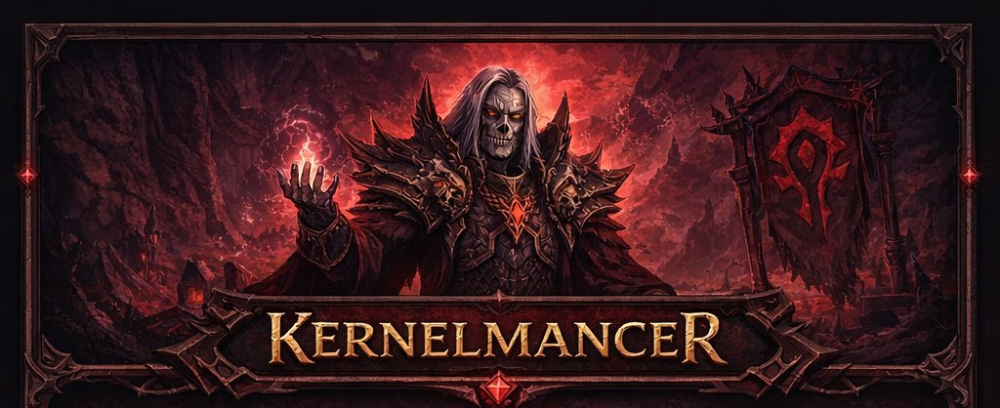

<i>Proxy cores · Network clients · Infrastructure — Go, Kotlin, Linux</i>

  
  

---

## 🛠️ Maintaining

| Project | What | Stack |
| --- | --- | --- |
| [**SlothClash**](https://github.com/Nemu-x/SlothClash) ⭐ 412 | Desktop Clash.Meta / mihomo client (fork of clash-verge-rev) — 77 PRs merged | Go · TypeScript |
| [**ClashFest**](https://github.com/Nemu-x/ClashFest) ⭐ 237 | Rule-based tunnel for Android (fork of ClashMetaForAndroid) — 190 PRs merged | Kotlin · Go |
| [**SwissKnife for MS Graph**](https://github.com/Nemu-x/SwissKnife-for-MS-Graph) | Cross-platform Microsoft 365 admin runtime: Graph, Exchange, Teams, on-prem AD; every change previewed and audited | Go |
| [**clash-companion**](https://github.com/Nemu-x/clash-companion) | LAN protocol + Go library to discover, pair with and remote-control mihomo clients. No cloud | Go |

## 🍊 Core work — [getmikan/Citrus](https://github.com/getmikan/Citrus)

Proxy core for [Mikan](https://github.com/Miroshka000/mikan) (mihomo fork) — **129 PRs merged**, plus patches to its `tls`, `utls` and `smux` forks.

- Relay under load: echo RTT **55–63 ms → 20 ms**
- Less memory per idle tunnel and fewer GC cycles / allocations per new connection
- Hysteria2 / TUIC / AnyTLS hot paths; fixed a TUIC CONNECT panic and a smux write race
- Benchmarks vs Xray-core, sing-box and mihomo; nightly perf check and `-race` job in CI

## ⚔️ Upstream

| Repo | Contribution |
| --- | --- |
| [MetaCubeX/mihomo](https://github.com/MetaCubeX/mihomo/pulls?q=author%3ANemu-x) | **XHTTP transport for VLESS** — base transport, stream-up, download-settings, xmux `reuse-settings` (6 merged) |
| [clash-verge-rev](https://github.com/clash-verge-rev/clash-verge-rev/pulls?q=author%3ANemu-x) | Full Russian localization, incl. Windows installer |
| [PasarGuard/panel](https://github.com/PasarGuard/panel/pulls?q=author%3ANemu-x) | XHTTP in Clash Meta subscriptions, Hysteria2 SNI fix |
| [enfein/mieru](https://github.com/enfein/mieru/pulls?q=author%3ANemu-x) | ClashFest & SlothClash listed as official third-party clients |

## 🧰 Stack

  
   
  

  
  
  
  
  
  
  
  
  

---

  

  <picture>
    <source media="(prefers-color-scheme: dark)" srcset="https://raw.githubusercontent.com/Nemu-x/Nemu-x/output/contrib-3d-dark.svg" />
    
  </picture>

  
  &nbsp;<b>Discipline above chaos. For the Horde. For uptime.</b>&nbsp;
  

